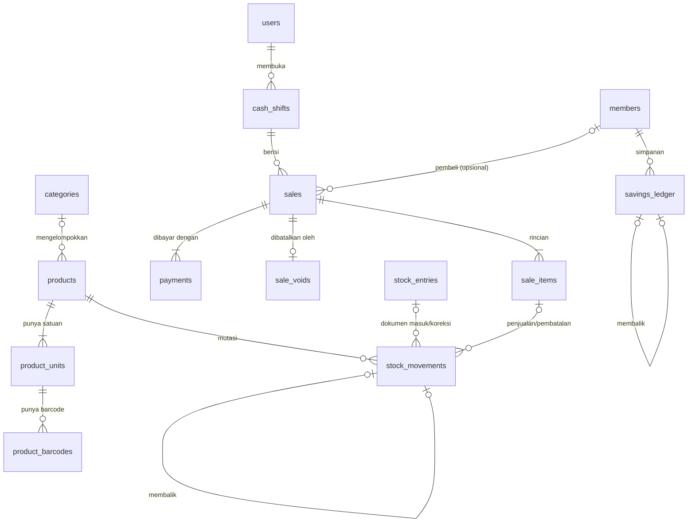

# Rancangan Skema Database — Tahap 0 (versi tugas)

Status: **DRAF, menunggu persetujuan.** Belum ada kode atau migration.
Revisi: 21 Nov 2026. Acuan: `CLAUDE.md`, bagian "Versi tugas".

Ini proyek tugas kuliah, bukan produksi. Skema dibuat sesederhana mungkin, tetapi aturan ledger tetap dijaga.

Tanda:

- **[usulan]**: tidak tercantum di `CLAUDE.md`, perlu disetujui.
- Keputusan yang masih terbuka ada di bagian 9.

---

## 0. Keputusan yang sudah ditetapkan

| # | Keputusan |
| --- | --- |
| D1 | Satu koperasi, satu toko. Tidak ada multi tenant dan tidak ada kolom gudang. |
| D2 | Database **MySQL 8** (`CHECK` constraint berlaku sejak 8.0.16). |
| D3 | Tiga peran: `admin`, `kasir`, `bendahara`. |
| D4 | Stok disimpan sebagai bilangan bulat dalam satuan dasar (pcs, gram, ml). |
| D5 | Keranjang ada di browser. Baris `sales` baru dibuat saat pembayaran selesai. |
| D6 | Simpanan dicatat bendahara, terpisah dari laci kasir. |
| D7 | Waktu disimpan UTC dan ditampilkan dalam `Asia/Jakarta`. |

**Dibuang untuk versi tugas:** trigger database, kolom gudang, retur setelah shift tutup, penguncian anti-deadlock, `client_uuid`, tes keserentakan, mode offline, QRIS, WhatsApp.

---

## 1. Prinsip ledger (stok dan simpanan)

1. **Hanya bisa ditambah.** Baris `stock_movements` dan `savings_ledger` tidak pernah di-`UPDATE` atau di-`DELETE`. Tidak ada `soft deletes` dan tidak ada `updated_at`.
2. **Saldo = jumlah mutasi.** Tabel master (`products`, `members`) tidak punya kolom saldo.
3. **`balance_after` di setiap baris.** Saldo sesudah mutasi ditulis sekali saat insert. Saldo terkini adalah `balance_after` baris terakhir, dan kartu stok atau buku simpanan bisa langsung ditampilkan.
4. **Koreksi lewat mutasi baru.** Kesalahan diperbaiki dengan baris pembalik (`reverses_*_id` menunjuk baris asal) atau baris penyesuaian, selalu dengan alasan.
5. **Satu pintu.** Hanya `AdjustStock` dan `PostSaving` yang menulis ke ledger. Action lain memanggil keduanya.
6. **Urutan resmi = `id`.** `occurred_at` hanya informasi.
7. **Penjagaan:** Action satu pintu, model Eloquent ledger melempar exception saat `updating` / `deleting`, dan tes Pest.
8. **Satu transaksi database per aksi.** Saat menghitung `balance_after`, baris saldo terakhir dibaca dengan `lockForUpdate()` biasa. Tidak ada aturan urutan kunci.

---

## 2. Diagram relasi

---

## 3. Tabel

Konvensi:

- PK `id` bigint.
- Uang ditulis `rupiah`: `bigint`, rupiah bulat.
- Jumlah barang: `int` dalam satuan dasar.
- Tabel master memakai `timestamps` + `softDeletes`. Tabel ledger hanya `created_at`.
- Tabel transaksi punya `created_by` (FK `users`).

### 3.1 Pengguna dan peran

**`users`** (bawaan Laravel) + `is_active` (bool) + `deleted_at`.

**Tabel spatie/laravel-permission**: struktur bawaan paket.

| Peran | Hak |
| --- | --- |
| `admin` | semua: pengguna, produk, stok masuk dan koreksi, pembatalan penjualan, laporan, log aktivitas |
| `kasir` | buka dan tutup shift, membuat penjualan |
| `bendahara` | anggota, setoran dan penarikan simpanan, pembalikan simpanan, laporan |

### 3.2 Inventaris

**`categories`**: `name`, timestamps, soft deletes.

**`products`**

| Kolom | Tipe | Keterangan |
| --- | --- | --- |
| sku | string unik | |
| name | string | |
| category_id | FK null | |
| min_stock | int | dalam satuan dasar |
| is_active | bool | |
| timestamps, deleted_at | | |

Tidak ada kolom `stock`.

**`product_units`**

| Kolom | Tipe | Keterangan |
| --- | --- | --- |
| product_id | FK | |
| name | string | `pcs`, `pak`, `dus`, `gram` |
| conversion | int ≥ 1 | isi satuan dasar per satuan ini (dus = 24) |
| is_base | bool | tepat satu per produk, dengan `conversion` = 1 |
| sell_price | rupiah | harga jual per satuan ini |
| timestamps, deleted_at | | |

Aturan: unik `(product_id, name)`. `conversion` tidak boleh diubah setelah satuan dipakai di mutasi atau penjualan.

**`product_barcodes`** **[usulan]**

| Kolom | Tipe | Keterangan |
| --- | --- | --- |
| product_unit_id | FK | barcode menunjuk satuan |
| barcode | string unik | |

Bila tidak disetujui: kolom `barcode` unik null di `product_units` (lihat Q1).

**`stock_entries`** **[usulan]**: dokumen barang masuk dan koreksi.

| Kolom | Tipe | Keterangan |
| --- | --- | --- |
| number | string unik | `BM-20261121-0001` |
| type | enum | `opening`, `receipt`, `adjustment` |
| supplier_name | string null | teks bebas |
| note | text null | wajib untuk `adjustment` |
| occurred_at | datetime | |
| created_by, created_at | | tidak bisa diubah |

**`stock_movements`** (ledger stok)

| Kolom | Tipe | Keterangan |
| --- | --- | --- |
| product_id | FK | |
| type | enum | `opening`, `receipt`, `sale`, `sale_void`, `adjustment` |
| qty | int ≠ 0, bertanda | `+` masuk, `−` keluar, satuan dasar |
| balance_after | int | saldo produk setelah mutasi |
| input_unit_id | FK `product_units` | satuan yang diketik (misalnya dus) |
| input_qty | int | jumlah dalam satuan itu. `qty` = `input_qty × conversion` |
| cost_total | rupiah null | harga beli total, untuk `opening` dan `receipt` |
| stock_entry_id | FK null | untuk `opening`, `receipt`, `adjustment` |
| sale_item_id | FK null | untuk `sale`, `sale_void` |
| reverses_movement_id | FK null, unik | baris yang dibalik; unik agar tidak bisa dibalik dua kali |
| note | string null | |
| occurred_at | datetime | |
| created_by, created_at | | |

Constraint: `CHECK (qty <> 0)`. Indeks `(product_id, id)`.

| type | Tanda | Sumber |
| --- | --- | --- |
| `opening` | + | `stock_entries` |
| `receipt` | + | `stock_entries` |
| `sale` | − | `sale_items` |
| `sale_void` | + | `sale_items`, wajib `reverses_movement_id` |
| `adjustment` | ± | `stock_entries`, wajib alasan |

### 3.3 Kasir

**`cash_shifts`**

| Kolom | Tipe | Keterangan |
| --- | --- | --- |
| user_id | FK | kasir |
| opened_at | datetime | |
| opening_cash | rupiah ≥ 0 | |
| closed_at | datetime null | null = aktif |
| counted_cash | rupiah null | uang fisik saat tutup |
| expected_cash | rupiah null | dihitung sistem saat tutup |
| difference | rupiah null | `counted_cash − expected_cash` |
| closing_note | text null | wajib bila selisih ≠ 0 |
| timestamps | | |

Aturan: satu shift aktif per kasir (dicek di Action `OpenShift`). Transisi hanya `aktif → tutup`, sekali. Setelah tutup, baris tidak diubah.

**`sales`**: dibuat sekali dalam keadaan selesai, tidak pernah diubah.

| Kolom | Tipe | Keterangan |
| --- | --- | --- |
| number | string unik | `INV-20261121-0001` |
| cash_shift_id | FK | |
| member_id | FK null | |
| subtotal | rupiah | Σ `qty × unit_price` |
| item_discount_total | rupiah | Σ diskon baris |
| sale_discount | rupiah | diskon transaksi |
| total | rupiah ≥ 0 | `subtotal − item_discount_total − sale_discount` |
| created_by, created_at | | |

**`sale_items`**: salinan data produk saat transaksi.

| Kolom | Tipe | Keterangan |
| --- | --- | --- |
| sale_id | FK | |
| product_id, product_unit_id | FK | |
| product_name, unit_name | string | salinan |
| conversion | int | salinan |
| qty | int > 0 | dalam satuan yang dijual |
| base_qty | int | `qty × conversion` |
| unit_price | rupiah | salinan harga saat itu |
| discount | rupiah ≥ 0 | ≤ `qty × unit_price` |
| line_total | rupiah | `qty × unit_price − discount` |

**`payments`**

| Kolom | Tipe | Keterangan |
| --- | --- | --- |
| sale_id | FK | |
| method | enum | `cash` saja (QRIS dibuang di versi tugas; enum memudahkan menambah cara bayar nanti) |
| amount | rupiah > 0 | |
| tendered | rupiah | uang diterima |
| change | rupiah | `tendered − amount` |
| created_at | | |

Aturan: Σ `payments.amount` = `sales.total`.

**`sale_voids`** **[usulan]**: pembatalan, agar `sales` tetap tidak di-update.

| Kolom | Tipe | Keterangan |
| --- | --- | --- |
| sale_id | FK unik | sekali saja |
| reason | string | wajib |
| created_by, created_at | | `admin` |

### 3.4 Anggota dan simpanan

**`members`**

| Kolom | Tipe | Keterangan |
| --- | --- | --- |
| member_number | string unik | `A-000123`, tidak dipakai ulang (hanya soft delete) |
| name | string | |
| phone, address | string null | |
| joined_at | date | |
| status | enum | `active`, `exited` |
| exited_at | date null | |
| qr_token | string unik | isi QR kartu anggota (token acak) |
| timestamps, deleted_at | | |

**`savings_rates`** **[usulan]**: besaran pokok dan wajib.

| Kolom | Tipe | Keterangan |
| --- | --- | --- |
| savings_type | enum | `pokok`, `wajib` |
| amount | rupiah > 0 | |
| effective_from | date | tarif baru = baris baru |
| created_by, created_at | | |

Bila tidak disetujui: dua nilai tetap di `config/koperasi.php` (lihat Q3).

**`savings_ledger`** (ledger simpanan)

| Kolom | Tipe | Keterangan |
| --- | --- | --- |
| number | string unik | `SP-20261121-0001` |
| member_id | FK | |
| savings_type | enum | `pokok`, `wajib`, `sukarela` |
| entry_type | enum | `deposit`, `withdrawal`, `reversal` |
| amount | rupiah ≠ 0, bertanda | `+` setor, `−` tarik |
| balance_after | rupiah ≥ 0 | saldo anggota untuk jenis ini |
| period | date null | bulan wajib yang dibayar (tanggal 1) |
| reverses_entry_id | FK null, unik | |
| note | string null | wajib untuk `reversal` |
| occurred_at | datetime | |
| created_by, created_at | | |

Constraint: `CHECK (amount <> 0)`, `CHECK (balance_after >= 0)`. Indeks `(member_id, savings_type, id)`.

### 3.5 Umum

**`activity_logs`**: tabel sendiri, append-only.

| Kolom | Tipe | Keterangan |
| --- | --- | --- |
| user_id | FK null | |
| action | string | `product.price_changed`, `sale.voided`, ... |
| subject_type, subject_id | morph | |
| properties | json | nilai lama dan baru |
| created_at | | |

Dicatat untuk: perubahan harga, buka dan tutup shift, pembatalan, koreksi stok, pembalikan simpanan, anggota keluar.

Nomor dokumen (`INV-`, `BM-`, `SP-`, `A-`) dibuat dari nomor urut terakhir hari itu di dalam transaksi yang sama. Tidak ada tabel penomoran terpisah.

---

## 4. Aturan stok

| # | Aturan |
| --- | --- |
| S1 | Stok produk = `balance_after` baris terakhir = Σ `qty`. |
| S2 | `AdjustStock` dalam satu transaksi: baca saldo terakhir, hitung `balance_after`, insert. |
| S3 | `qty` selalu dalam satuan dasar. |
| S4 | Mutasi `adjustment` yang membuat saldo minus ditolak. Penjualan: lihat Q2. |
| S5 | Baris pembalik: `qty` = −`qty` asal, `reverses_movement_id` unik. `sale_void` hanya membalik `sale`. |
| S6 | Peringatan stok minimum bila saldo ≤ `min_stock` (tampilan saja). |

## 5. Aturan simpanan

| # | Aturan |
| --- | --- |
| T1 | Saldo per anggota per jenis = `balance_after` baris terakhir = Σ `amount`. |
| T2 | `PostSaving` menolak mutasi yang membuat saldo < 0. |
| T3 | **Pokok**: disetor sekali sebesar tarif. Tidak bisa ditarik selama anggota aktif. |
| T4 | **Wajib**: setoran mengisi `period`, satu bulan sekali (baris yang sudah dibalik tidak dihitung). Ditarik hanya saat keluar. |
| T5 | **Sukarela**: setor dan tarik kapan saja selama saldo tidak minus. |
| T6 | **Keluar anggota** (`ExitMember`): satu transaksi, tarik semua saldo lalu status `exited`. Setelah itu tidak ada mutasi baru kecuali pembalikan. |
| T7 | Pembalikan: `amount` = −`amount` asal, `reverses_entry_id` unik, alasan wajib. |
| T8 | Hanya `bendahara` (dan `admin`) yang mencatat simpanan. |

## 6. Aturan kasir dan uang

| # | Aturan |
| --- | --- |
| K1 | Penjualan butuh shift aktif milik kasir itu. |
| K2 | Server menghitung ulang harga dari `product_units.sell_price`. Harga dari browser diabaikan. |
| K3 | `CompleteSale`, satu transaksi: insert `sales`, `sale_items`, `payments`, panggil `AdjustStock(sale)` per baris, cek Σ pembayaran = total. `SaleCompleted` dipancarkan setelah commit. |
| K4 | Diskon baris ≤ nilai baris; total ≥ 0. |
| K5 | `VoidSale`: hanya selama shift masih aktif, oleh `admin`, alasan wajib. Insert `sale_voids`, lalu `AdjustStock(sale_void)` untuk setiap baris. Penjualan dari shift yang sudah tutup tidak bisa dibatalkan. |
| K6 | `expected_cash` = `opening_cash` + Σ `amount` pembayaran tunai dari penjualan yang tidak dibatalkan di shift itu. Dibekukan saat tutup. |

## 7. Tes Pest wajib

**Tahap 2 (stok)**

- Saldo = Σ `qty` = `balance_after` terakhir setelah campuran masuk, keluar, koreksi.
- Menerima 2 dus (isi 24) menambah 48 satuan dasar.
- Barcode dus terbaca sebagai satuan dus.
- Baris ledger tidak bisa di-update atau di-delete.
- `adjustment` yang membuat saldo minus ditolak.
- Baris yang sama tidak bisa dibalik dua kali.
- `conversion` satuan yang sudah dipakai tidak bisa diubah.

**Tahap 3 (kasir)**

- Penjualan mengurangi stok sesuai `base_qty`.
- Harga dari browser diabaikan.
- Pembatalan mengembalikan stok dan tidak bisa dua kali.
- Pembatalan setelah shift tutup ditolak.
- `expected_cash` dan `difference` benar, termasuk dengan pembatalan.
- Kasir tidak bisa membuka dua shift aktif.
- Kasir tidak bisa membatalkan penjualan.

**Tahap 4 (simpanan)**

- Saldo per jenis = Σ `amount`.
- Penarikan sukarela melebihi saldo ditolak.
- Penarikan pokok atau wajib saat aktif ditolak.
- Setoran wajib bulan yang sama dua kali ditolak; setelah dibalik boleh lagi.
- Keluar anggota mengosongkan saldo dan menutup mutasi berikutnya.
- Nomor anggota tidak dipakai ulang.
- Kasir tidak bisa mencatat simpanan.

## 8. Bonus Tahap 7 (sketsa, belum dibuat)

| Tabel | Catatan |
| --- | --- |
| `loans`, `loan_installments` | pinjaman sederhana; anggota tidak bisa keluar bila masih punya pinjaman |
| `shu_periods`, `shu_allocations` | SHU dari jasa modal (saldo simpanan) dan jasa usaha (`sales.member_id`) |

## 9. Keputusan yang masih terbuka

| Kode | Pertanyaan | Rekomendasi |
| --- | --- | --- |
| Q1 | Barcode di tabel terpisah `product_barcodes`, atau satu kolom di `product_units`? | Satu kolom saja, cukup untuk tugas |
| Q2 | Bila stok sistem kurang, penjualan ditolak atau tetap jalan dengan peringatan? | Ditolak. Lebih sederhana dan mudah diuji; data contoh dibuat dengan stok cukup |
| Q3 | Tarif pokok dan wajib di tabel `savings_rates` atau di berkas config? | Berkas config |
| Q4 | Setujui `stock_entries` dan `sale_voids`? | Ya. Keduanya menjaga aturan "penjualan tidak diedit" dan "koreksi lewat dokumen" tanpa menambah rumit |
